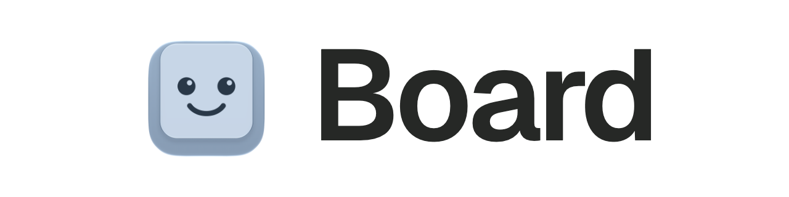
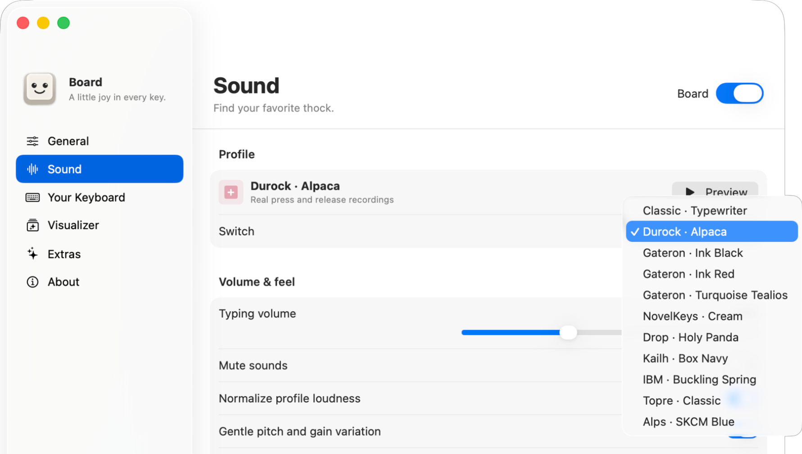
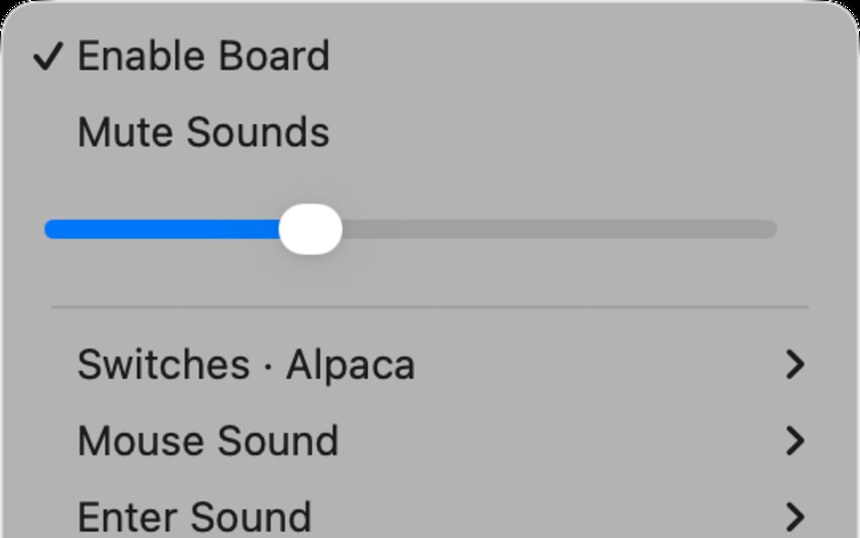
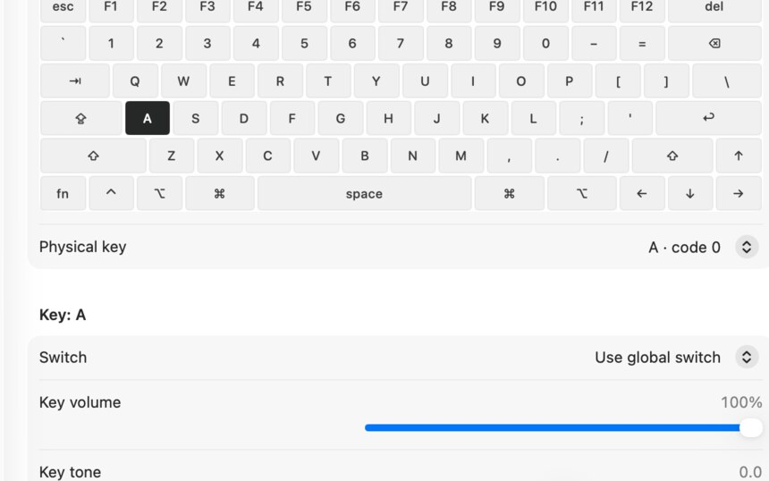
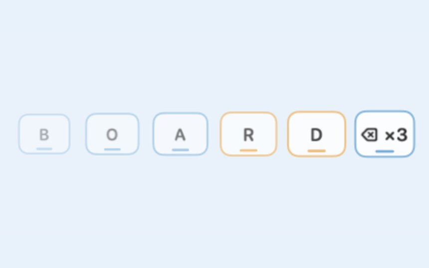
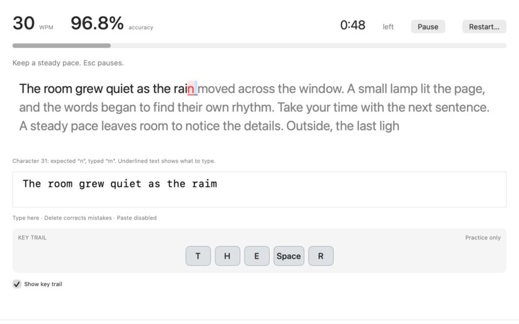
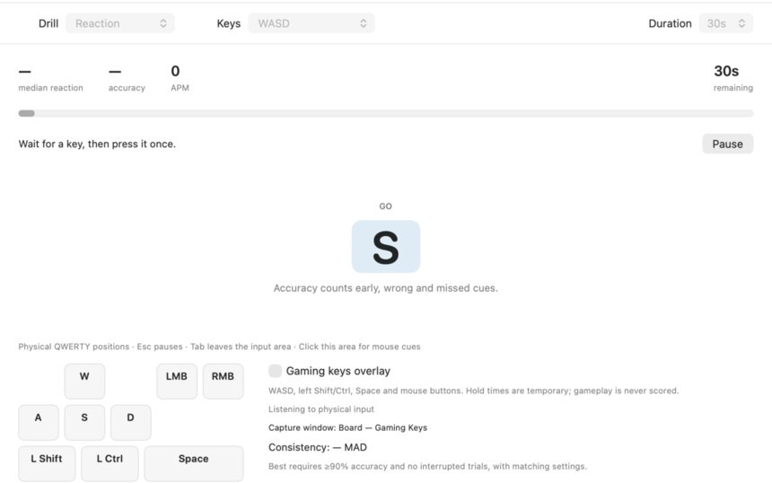
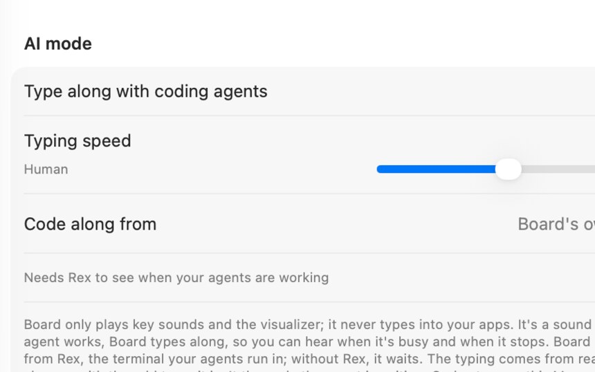

<h1 align="center">
  <picture>
    <source media="(prefers-color-scheme: dark)" srcset="Docs/images/readme-header-dark@2x.png">
    
  </picture>
</h1>

Board plays the sound of a mechanical keyboard or typewriter as you type across your Mac.

Eleven recorded sounds, on-screen visualizers and typing practice. No account, server or network.

  <a href="https://github.com/tommyent/board/releases/latest"><strong>Download</strong></a> ·
  <a href="https://tommyent.github.io/board/"><strong>Website</strong></a> ·
  <a href="Docs/FEATURES.md"><strong>All features</strong></a> ·
  <a href="Docs/"><strong>Docs</strong></a>

## Features

Click a picture to see it full size.

<table>
  <tr>
    <td width="33%" valign="top"> <b>Menu bar controls</b> keep your sound choices close</td>
    <td width="33%" valign="top"> <b>Your Keyboard</b> gives each key its own sound and feel</td>
    <td width="33%" valign="top"> <b>Keystroke visualizers</b> show the rhythm of your typing</td>
  </tr>
  <tr>
    <td width="33%" valign="top"> <b>Typing practice</b> with passages, results and personal bests</td>
    <td width="33%" valign="top"> <b>Gaming drills</b> for reaction and key rhythm</td>
    <td width="33%" valign="top"> <b>AI mode</b> plays along while your coding agents work</td>
  </tr>
</table>

Choose from eleven recorded switch and typewriter sounds, import your own, and set sounds for individual keys, Enter and mouse buttons. AI mode can play along while a coding agent works in Rex. [Explore all features →](Docs/FEATURES.md)

## Install

1. [Download Board 0.4.10](https://github.com/tommyent/board/releases/download/v0.4.10/Board-0.4.10.zip) and open the ZIP.
2. Move `Board.app` to Applications and open it.
3. Grant Input Monitoring in Board's first-run Settings window, then quit and reopen Board. [First-run help →](Docs/GETTING_STARTED.md)

Tested on macOS 26.5.1, 27.0.1 and 27.3 on Apple silicon. The release is signed and notarized.

## Docs

[Features](Docs/FEATURES.md) · [Install and first run](Docs/GETTING_STARTED.md) · [Privacy and permissions](Docs/PRIVACY.md) · [Build from source](Docs/BUILDING.md) · [Verification](Docs/VERIFICATION.md)

## Credits and licence

Bundled sound sources and credits are in the [asset inventory](Docs/asset-manifest.json) and [references](Docs/References). Board is released under the [MIT License](LICENSE).
