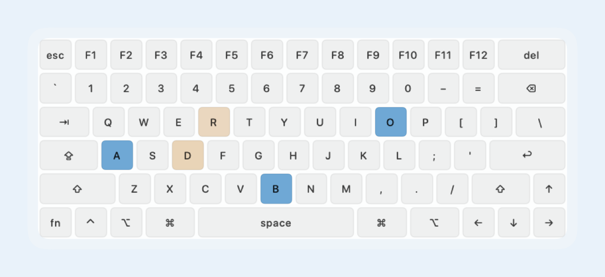
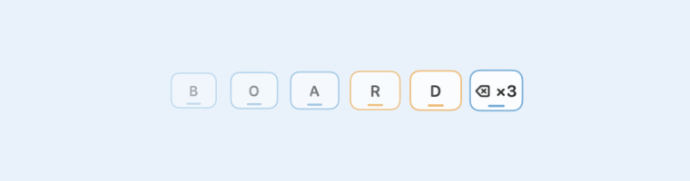
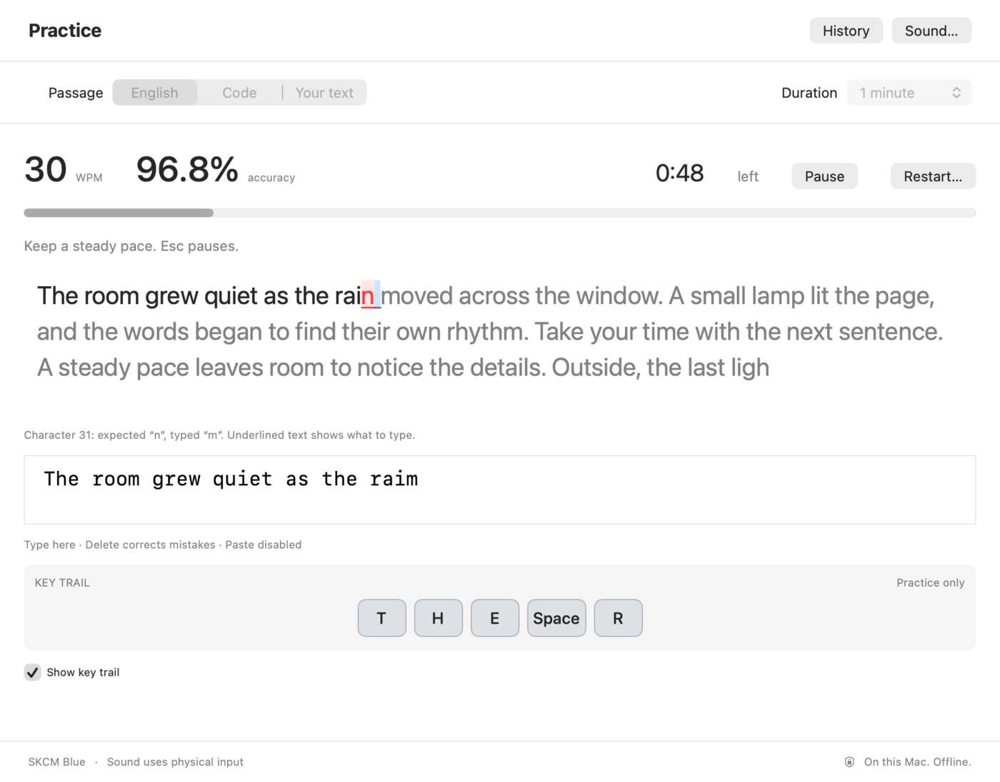
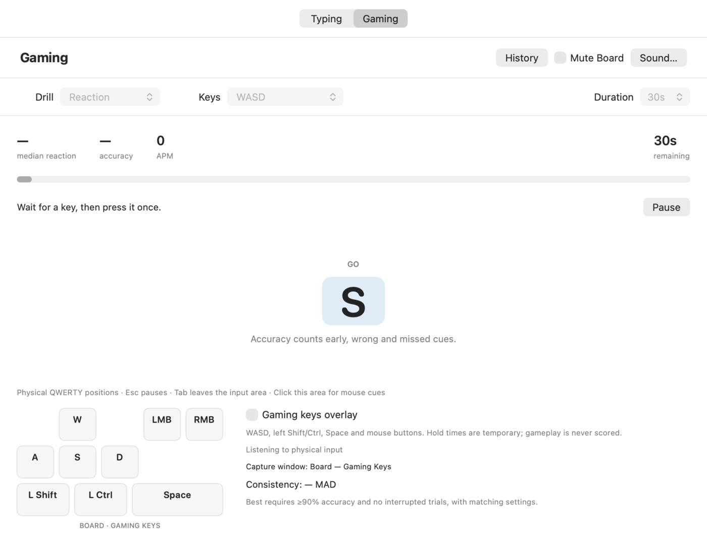

# Board

Board is a Mac app that plays the sound of a mechanical keyboard, or a typewriter, as you type. It plays sounds across your apps, except while macOS Secure Input is on, as in a password field. It runs from the menu bar and stays on your Mac: no account, no server, no network.

It comes with eleven recorded sounds, on-screen visualizers that show your keystrokes, a typing practice window, practice drills for games, and a mode that lets you hear when your coding agents are busy.



## Install

Board needs a Mac with Apple silicon. It is built for macOS 15 or later. It has been run on macOS 26.5.1 and on macOS 27.0.1 to 27.3, and not on macOS 15 itself.

The release is on this repository's [Releases](https://github.com/tommyent/board/releases) page. The repository is private, so the download needs access to it; there is no public download yet. With access you can also [build Board from source](#build-from-source).

1. Download `Board-<version>.zip` from Releases and open it.
2. Move `Board.app` to your Applications folder.
3. Open Board. The first time, macOS asks whether you want to open an app downloaded from the internet; choose **Open**. The release is signed with Developer ID and notarized by Apple.
4. Board opens its Settings window. To hear sounds in other apps, Board needs the **Input Monitoring** permission:
   - Choose **Request Input Monitoring**.
   - If macOS shows a prompt, choose **Open System Settings**. If no prompt appears, choose **Open Input Monitoring Settings** in Board.
   - In **Privacy & Security › Input Monitoring**, switch Board on. macOS asks for your password.
   - Quit Board and open it again. If macOS offers **Quit & Reopen**, choose it.
5. Check that Settings says **Listening to physical input**, then choose **Got it — continue** to finish the first run.

Without the permission Board still opens, and the sound previews in Settings work, but it can't hear your keys in other apps.

If Board is missing from the Input Monitoring list: on macOS 26.5.1, no prompt appeared and the list stayed empty in testing. The **+** button under the list adds an app by hand, but that route has not been tested to the end.

Keep `Board.app` in one place. macOS ties the permission to the app's identifier and signing identity, so an update signed with the same identity keeps it. The two updates tested so far did.

## How it behaves

- **It stays out of the way.** Board does not open Settings when it starts, so starting it at login doesn't interrupt you. It opens Settings by itself only on the first run, until you choose **Got it — continue**, and whenever Input Monitoring is off.
- **Opening Board again opens Settings.** If Board is already running, opening it from Finder, Spotlight or the Dock shows Settings. This also works when you have hidden both of Board's icons.
- **The menu bar icon** has the everyday controls: turn Board on or off, mute, volume, the switch, mouse and Enter sounds, favorites, the visualizer, Practice and Settings.
- **A global shortcut turns Board on and off:** Control–Option–Command–K. You can change the key and how many taps it takes in **Settings › General**.
- **Icons:** Board can show a menu bar icon, a Dock icon, both or neither (**Settings › General**). The app icon comes in five colors: Porcelain, Sage, Blue, Lilac and Graphite.

## Sounds

Eleven profiles, each a set of real recordings:

| Brand | Sound |
|---|---|
| Classic | Typewriter |
| Durock | Alpaca |
| Gateron | Ink Black |
| Gateron | Ink Red |
| Gateron | Turquoise Tealios |
| NovelKeys | Cream |
| Drop | Holy Panda |
| Kailh | Box Navy |
| IBM | Buckling Spring |
| Topre | Classic |
| Alps | SKCM Blue |

Board starts on Durock Alpaca. Pick another under **Settings › Sound**, or from the menu bar icon.

- Keys make a sound when you press them and another when you let go, as a real switch does. The typewriter plays one full stroke per press.
- You can give single keys their own sound, save six favorites, and import your own recordings.
- The mouse buttons and the Enter key can have their own sound, the same as the keyboard, or none. Typing, mouse and Enter each have their own volume.
- Sounds are placed left to right by where the key sits on the keyboard, and you can choose the output device.

## Visualizers

Board can show what you type on screen, in one of four styles:

- **Keyboard:** a small keyboard that lights each key as you press it. Released keys glow for a moment.
- **Keystrokes:** a ribbon of your last 15 keys. Each one fades out in about two seconds. Quick repeats of one key merge into a single cap with a count, such as `⌫ ×3`.
- **Combo:** a counter that climbs while you keep typing and starts again after a pause.
- **Bezel:** a border around the edge of the screen, in the color of the selected switch.



Keys are drawn in the color of their switch. You can choose where the visualizer sits, how big it is, how keys move (Pop, Slide, Bounce, Pulse, and Float for Keystrokes), and an ANSI, ISO or JIS layout. With Reduce Motion on in macOS, keys only fade.

## Practice

A typing test in its own window. Open **Practice…** from Board's menu, or press Command–Shift–P while Board is in front.



- Type an English passage, code in Swift, JavaScript or Python, or your own text.
- Attempts last 30 seconds, 1 minute or 2 minutes.
- You see words per minute, accuracy, marked mistakes and a trail of your keys, and Board keeps your results and personal bests.

## Gaming practice

The **Gaming** tab in the Practice window trains the key presses games ask for. Each drill runs for 30, 60 or 120 seconds.



- **Reaction:** a key or mouse button appears; press it as fast as you can.
- **Strafe rhythm:** alternate D and A on the beat.
- **Key reversal:** hold one key, then switch to the opposite one on GO.
- **Hold + tap:** hold left Shift while you tap Space on the beat.

The **Gaming keys overlay** is an optional small floating window that shows WASD, Shift, Ctrl, Space and the mouse buttons as you hold them. Clicks pass through it. Whether it shows over full-screen games hasn't been tested.

## AI mode

AI mode is a sound cue for coding agents. While an agent is working, Board types along, so you can hear when it's busy and when it stops. Turn it on under **Settings › Extras**.

- It only makes sound and drives the visualizer. Board never types into your apps.
- It needs Rex, the terminal the agents run in, to know when one is working. It follows Claude Code, Codex, Antigravity and Grok. Without Rex, AI mode waits and says so.
- What you hear is Board typing real source files, not the code your agent is writing. You choose the speed, from Human to Machine gun.

## Privacy

- Board reacts to which physical key or mouse button went down or up. It does not read, record or store what you type.
- Practice reads only the text you type into its own window. It saves result summaries (speed, accuracy, date), never the text or the keys.
- Board pauses while macOS Secure Input is on, for example in a password field.
- Nothing leaves your Mac. The app makes no network connection.
- Settings, results and imported sounds are stored on your Mac, in Board's preferences and in `~/Library/Application Support/Board/`.

## More detail

- [Board in detail](Docs/FEATURES.md): the exact rules for scoring, timing, history and pausing, and how AI mode works with Rex.
- [Verification ledger](Docs/VERIFICATION.md): what was tested and observed for each version, and what wasn't.

## Build from source

You need Xcode. Open `Board.xcodeproj` and run the **Board** scheme, or build a signed package from the command line:

```sh
bash Scripts/build.sh    # writes dist/Board.app
bash Scripts/test.sh     # runs the tests
```

[Building, signing and testing](Docs/BUILDING.md) covers signing identities, notarization and what the tests cover.

## Assets and provenance

Every bundled sound is listed with its origin, author and checksum in the [asset inventory](Docs/asset-manifest.json). Source notices are in [Docs/References](Docs/References), and the rest is described in [Building, signing and testing](Docs/BUILDING.md#assets-and-development-scripts).
